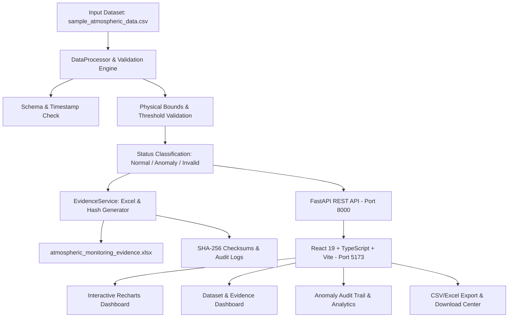

# NARL–CDMG Atmospheric Observation Data Monitoring and Anomaly Detection System

> **Internship Project**  
> **Associated Organization:** National Atmospheric Research Laboratory (NARL), Department of Space, Government of India. 
> **Host Group:** Computer & Data Management Group (CDMG)  
> **Mode:** Educational Prototype (Sample Data Mode)

---

## 1. Project Overview

The **Atmospheric Observation Data Monitoring and Anomaly Detection System** is an educational, full-stack scientific monitoring prototype developed during a six-week internship associated with the Computer & Data Management Group (CDMG) at the National Atmospheric Research Laboratory (NARL).

The system continuously reads atmospheric surface observations from CSV records, validates datetime schemas and physical boundaries, highlights unusual or out-of-range sensor readings using transparent rule-based anomaly detection, displays interactive time-series monitoring charts, and provides structured data exploration, filtering, and CSV/Excel export capabilities.

### Verifiable Dataset Storage & Project Evidence System
The application includes a complete **Dataset Storage & Project Evidence System** that provides verifiable, cryptographic proof that atmospheric datasets are stored, parsed, validated, and analyzed:
- **Dataset Storage Proof:** Exact relative paths, dimensions, file size in bytes, and column schemas verified on local disk.
- **Excel Evidence Workbook (`atmospheric_monitoring_evidence.xlsx`):** Multi-sheet workbook compiled dynamically via Python Pandas and OpenPyXL.
- **Processing Workflow Audit:** Complete 5-stage pipeline logs with execution timestamps and record counts.
- **File Integrity Proof:** SHA-256 cryptographic checksum calculation and live recalculation/verification with `PASS`/`FAIL` audit results.

> **Scientific Honesty & Demonstration Disclaimer**  
> This application is an educational software prototype running on synthetic demonstration datasets (`Sample Data Mode`). It does not claim direct network connectivity to live operational NARL radar instruments, real-time lidar telemetry, or internal institutional infrastructure. Anomaly detection is strictly deterministic and rule-based; no machine-learning or predictive forecasting models are claimed. File hashes verify local file integrity, not the external meteorological origin of the data.

---

## 2. System Architecture & Tech Stack



### Backend
- **Language:** Python 3.12
- **Framework:** FastAPI
- **Data Engineering:** Pandas, NumPy, OpenPyXL
- **Data Validation:** Pydantic v2
- **Web Server:** Uvicorn (ASGI)
- **Automated Testing:** Pytest (**25 comprehensive test cases, 100% passing**)

### Frontend
- **Framework:** React 19 with TypeScript
- **Build Tool:** Vite
- **Styling:** Tailwind CSS (Modern, clean scientific dashboard aesthetics)
- **Data Visualization:** Recharts (Interactive line charts with threshold limit lines and anomaly markers)
- **Icons:** Lucide React

---

## 3. Dataset Storage & Project Evidence System

### A. Local Storage Specifications
The active dataset is stored on disk in an organized project directory:
- **File Name:** `sample_atmospheric_data.csv`
- **Relative Path:** `backend/data/sample_atmospheric_data.csv`
- **Dimensions:** 144 rows × 4 columns
- **File Size:** 4.57 KB (4,678 bytes)
- **Verified Column Names:** `timestamp`, `temperature_c`, `humidity_percent`, `wind_speed_ms`
- **SHA-256 Checksum:** `595ec8bb63c39516132c2911f21e94cfc15a7be38a1c3ef3a0f821b9774c02dc`

### B. Excel Evidence Workbook (`atmospheric_monitoring_evidence.xlsx`)
A real Excel workbook generated dynamically using Python Pandas and OpenPyXL, containing 6 structured sheets:
1. `Raw_Data`: Unaltered original input records.
2. `Processed_Data`: Clean observations with status codes (`NORMAL`, `ANOMALY`, `INVALID`) and highlight formatting.
3. `Anomalies`: Detailed audit log of all flagged threshold violations and out-of-range sensor readings.
4. `Data_Summary`: High-level metrics, counts, latest valid surface readings, and operational metadata.
5. `Validation_Rules`: Active thresholds, physical plausibility limits, and meteorological rationale.
6. `Processing_Log`: Step-by-step pipeline execution milestones and timestamps.

### C. Processing Workflow & Execution Proof
Every processing run logs the full scientific workflow:
$$\text{CSV/Excel Input} \longrightarrow \text{Data Validation} \longrightarrow \text{Anomaly Detection} \longrightarrow \text{Graph Generation} \longrightarrow \text{Excel/CSV Export}$$
- Input filename and input SHA-256 hash.
- Total records read, invalid/missing count, and anomalies detected.
- Generation of output artifacts with individual SHA-256 hashes.

### D. File Integrity Proof (SHA-256 Verification)
Recalculates cryptographic hashes directly against files stored on disk:
- `atmospheric_monitoring_evidence.xlsx`
- `sample_atmospheric_data.csv`
- `processed_atmospheric_data.csv`
- `atmospheric_anomalies_report.csv`
- `processing_audit_log.txt`

A live **"Recalculate Hash"** button re-reads the file from disk and outputs `PASS` or `FAIL` with millisecond precision.

---

## 4. API Endpoints Reference

| Method | Endpoint | Description |
|---|---|---|
| `GET` | `/health` | Service health status, NARL-CDMG metadata, Sample Data Mode indicator |
| `GET` | `/api/summary` | Dynamic summary statistics, counts, and latest valid readings |
| `GET` | `/api/readings` | Paginated atmospheric readings with `search` and `status` query filters |
| `GET` | `/api/anomalies` | Breakdown of anomalies by atmospheric variable and rule reason |
| `GET` | `/api/config` | Active threshold configuration |
| `PUT` | `/api/config` | Update thresholds with server-side validation and immediate re-processing |
| `POST` | `/api/upload` | Upload and process custom atmospheric CSV file safely (preserves raw file) |
| `POST` | `/api/reset` | Restore bundled 24-hour synthetic demonstration dataset |
| `GET` | `/api/export` | Download processed dataset as CSV matching Figure B.2 |
| `GET` | `/api/export/anomalies` | Download detailed anomaly audit report as CSV |
| **GET** | `/api/evidence/storage-info` | Verified metadata of stored input dataset (path, size, rows, columns, SHA-256) |
| **GET** | `/api/evidence/files` | List of all registered project files with SHA-256 hashes and PASS/FAIL status |
| **POST** | `/api/evidence/verify-hash` | Recalculate file hash on disk and compare against recorded checksum |
| **GET** | `/api/evidence/history` | Historical log of dataset processing runs and workflow stages |
| **GET** | `/api/evidence/raw-preview` | First N rows of raw input dataset for side-by-side inspection |
| **GET** | `/api/evidence/excel` | Download `atmospheric_monitoring_evidence.xlsx` (6 sheets) |
| **GET** | `/api/evidence/raw-csv` | Download original unaltered input dataset CSV |
| **GET** | `/api/evidence/log` | Download human-readable processing audit log text file |

Interactive Swagger documentation is available at `http://127.0.0.1:8000/docs`.

---

## 5. Execution Instructions (Windows PowerShell)

### Prerequisites
- Python 3.10+ (tested on Python 3.12)
- Node.js 18+ and npm (tested on Node v25.9)

### Option A: Running Backend
Open a terminal in the project directory:
```powershell
cd "e:\MY DOC\INTERSHIP PROJECT APP\backend"
python -m uvicorn main:app --host 127.0.0.1 --port 8000 --reload
```
*Backend runs on:* `http://127.0.0.1:8000`  
*API Documentation:* `http://127.0.0.1:8000/docs`

### Option B: Running Terminal Demonstration (Figure B.3)
```powershell
cd "e:\MY DOC\INTERSHIP PROJECT APP\backend"
python main.py
```

### Option C: Running Frontend
Open a second terminal:
```powershell
cd "e:\MY DOC\INTERSHIP PROJECT APP\frontend"
npm run dev -- --host 127.0.0.1 --port 5173
```
*Frontend runs on:* `http://127.0.0.1:5173`

---

## 6. Running Automated Tests

A comprehensive suite of **25 automated tests** verifies all functional and evidence requirements:
```powershell
cd "e:\MY DOC\INTERSHIP PROJECT APP"
python -m pytest backend/tests -v
```

### Verified Test Results (25 Passed):
- `test_evidence_1_input_dataset_exists` — Confirms input file exists on local disk and is non-empty.
- `test_evidence_2_storage_info_endpoint` — Validates path, dimensions, byte size, and SHA-256 length.
- `test_evidence_3_excel_generation_and_all_sheets_exist` — Inspects workbook with OpenPyXL, verifying all 6 sheets (`Raw_Data`, `Processed_Data`, `Anomalies`, `Data_Summary`, `Validation_Rules`, `Processing_Log`) and matching record counts.
- `test_evidence_4_file_hashes_and_verification` — Verifies SHA-256 calculation and `PASS` / `FAIL` behavior.
- `test_evidence_5_processing_workflow_history` — Confirms processing pipeline execution logs.
- `test_evidence_6_raw_dataset_preview` — Validates raw dataset column inspection.
- `test_evidence_7_downloads` — Confirms raw CSV and log downloads are accessible.
- Plus all 18 baseline tests covering data validation, out-of-range limits, negative wind speed, missing dropouts, upload validation, and exports.
